<p align="center">
  <a href="https://github.com/moradzadeh67/veliq">
    
  </a>
</p>

<p align="center">
  <a href="https://github.com/moradzadeh67/veliq/releases/latest">
    
  </a>
  <a href="https://opensource.org/licenses/MIT">
    
  </a>
  <a href="https://flutter.dev">
    
  </a>
  <a href="https://flutter.dev">
    
  </a>
  <a href="https://dart.dev">
    
  </a>
  <a href="https://github.com/moradzadeh67/veliq/actions/workflows/ci.yml">
    
  </a>
</p>

<p align="center">
  <a href="https://github.com/moradzadeh67/veliq/releases/latest"><b>📥 Download APK</b></a> •
  <a href="https://moradzadeh67.github.io/veliq/"><b>🌐 Website</b></a> •
  <a href="#-installation--running"><b>🚀 Build from Source</b></a> •
  <a href="#-features"><b>✨ Features</b></a> •
  <a href="#-architecture"><b>🏗️ Architecture</b></a> •
  <a href="#-screenshots"><b>📸 Screenshots</b></a> •
  <a href="#-demo"><b>🎬 Demo</b></a> •
  <a href="#-troubleshooting--faq"><b>❓ FAQ</b></a>
</p>

---

## 🌍 What is Veliq?

**Veliq** is a **free, open-source, local-first screen & photo translator** built with **Flutter**. It runs on **macOS, iOS and Android**.

Select any region of your screen — or pick / take a photo — extract its text **on-device**, and read the translation in Persian.

- ✅ **100% free** — no accounts, no ads, no tracking, no backend
- ✅ **MIT licensed** — read it, fork it, ship it
- ✅ **Local-first OCR** — screenshots and photos are held in memory and processed on-device (never uploaded)
- ✅ **Works out of the box** — free keyless translation by default, plus optional Google Gemini with your own key or Apple on-device translation

## 💡 Why I Built This

As a developer working on macOS and mobile devices, I frequently encounter English text on my screen — whether in documents, code comments, design specs, or system dialogs — that I want to extract and translate to Persian instantly. Existing browser-based translation tools require leaving the current app context, manually cropping or uploading screenshots to third-party cloud services, or retyping text by hand.

I built Veliq to solve this with a fast, keyboard-driven, local-first workflow. By combining native screen capture (ScreenCaptureKit on macOS, Photo Picker & Camera on mobile) with on-device Optical Character Recognition (Apple Vision, ML Kit and Tesseract), Veliq extracts on-screen text instantly without writing temporary image files to disk.

Only the clean extracted text ever leaves the device, and only on its way to the translation provider: Google Translate's free endpoint by default (no account, no key), or optionally Google Gemini with your own key, or Apple's on-device engine — keeping your workflow private, efficient and integrated into macOS, iOS and Android.

## 🎬 Demo

<p align="center">
  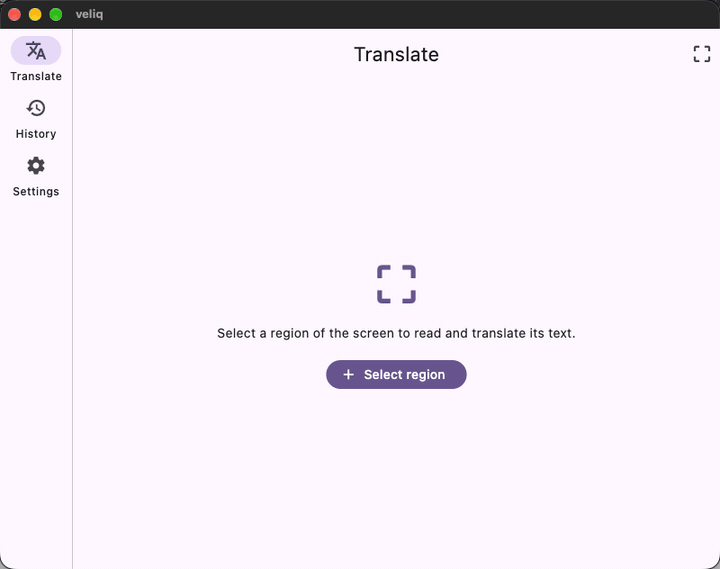
</p>

A short tour of the macOS flow: start on the Translate tab, drag a region over the screen, watch the on-device OCR run, read the Persian result in an RTL layout, and find it saved in the local history.

## 📸 Screenshots

### macOS
| Region Selection Overlay | Result & Persian Translation | History | Settings |
|:---:|:---:|:---:|:---:|
| 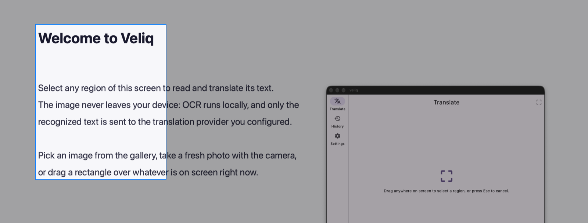 | 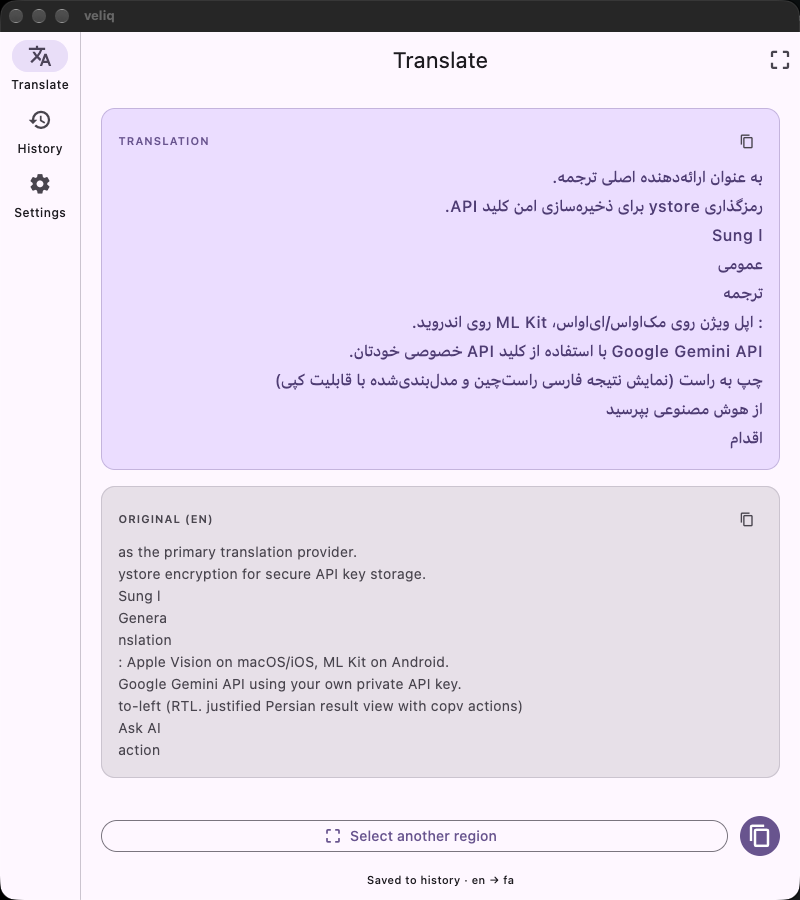 | 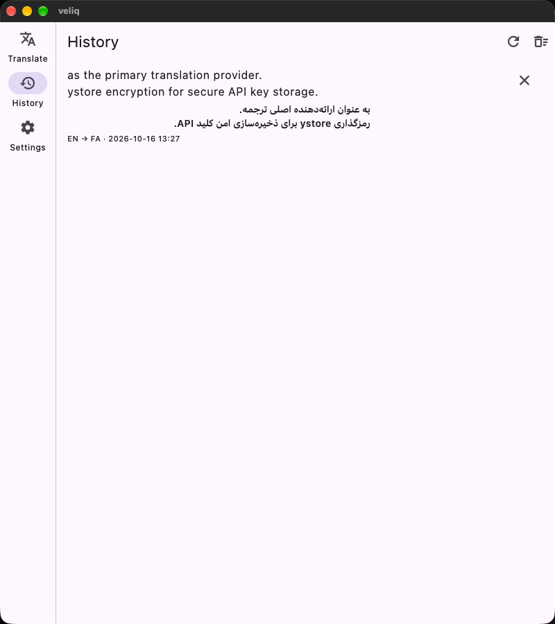 | 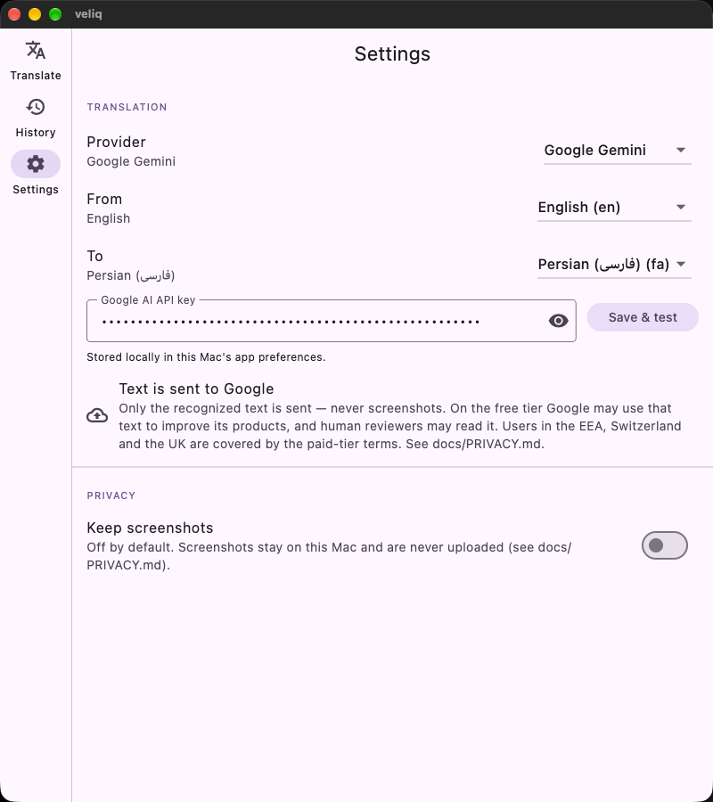 |

### Android
| Translate View | Photo Picker | Result View | History |
|:---:|:---:|:---:|:---:|
| 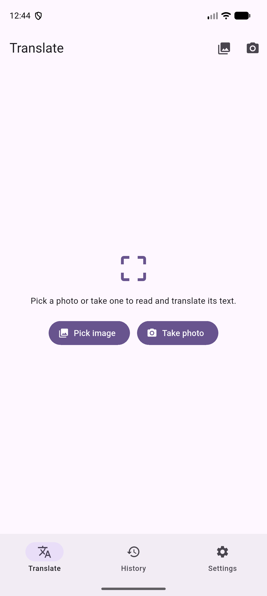 | 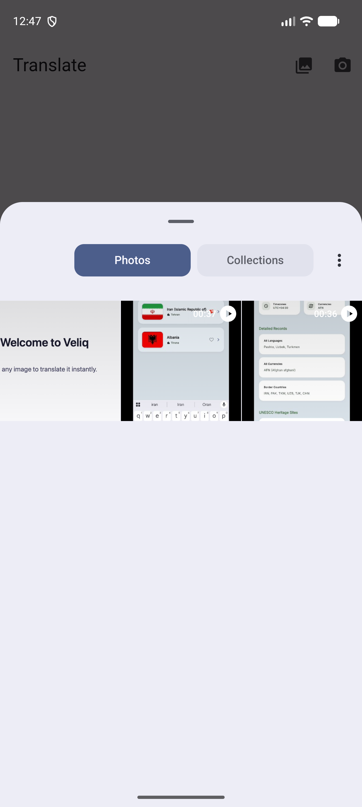 | 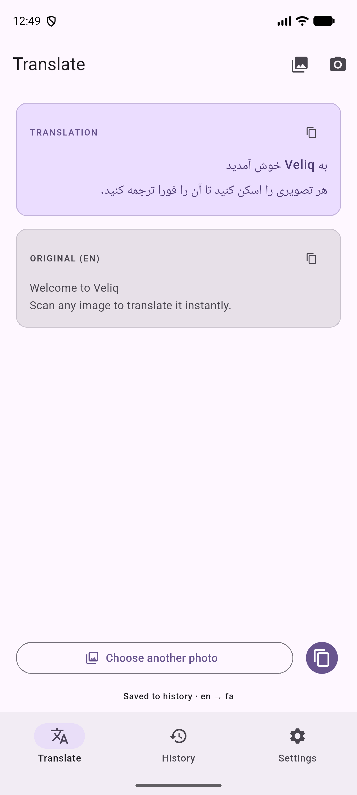 | 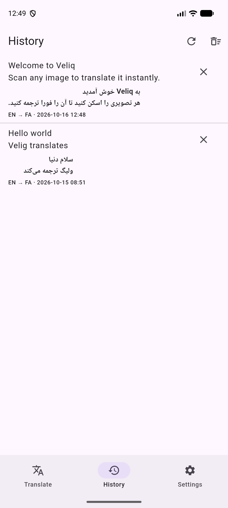 |

### iOS
| Home / Translate |
|:---:|
| 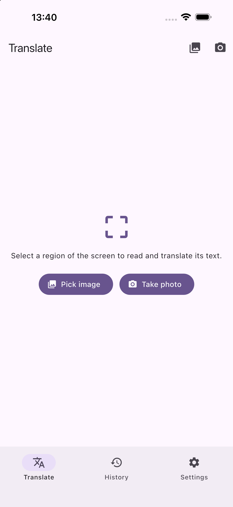 |

> 💡 **Note:** Screenshots live in `assets/screenshots/`, organised by platform.

## ✨ Features

### 🪟 Region Capture (macOS)
- Drag-select any region of the screen from a full-screen overlay; press `Esc` to cancel.
- Captured using **ScreenCaptureKit** and processed with **Apple Vision** OCR — 100% on-device.
- Screenshots are processed in memory and immediately discarded; zero image files written to disk.

### 📷 Photos & Camera (iOS)
- Pick a photo from the library (`PHPickerViewController`, no permissions needed) or take a new photo with the camera.
- On-device Apple Vision OCR, then translation through the provider you pick — Google Translate needs no key.
- `SafeArea`-aware layout with a native iOS bottom `NavigationBar`.

### 🤖 Photos & Camera (Android)
- Pick a photo with the system **Photo Picker** (no permissions required) or capture via camera (`ACTION_IMAGE_CAPTURE`).
- On-device OCR with two bundled engines: **ML Kit** for Latin script and **Tesseract** for Persian, Arabic and Russian. Both run offline and the photo stays in memory.
- **Google Translate (free, no key)** works out of the box; **Google Gemini** with your own key is optional.
- Optional API keys are encrypted with the Android Keystore.

### 🔍 OCR & Translation
- On-device OCR: **Apple Vision** on macOS/iOS; **ML Kit** plus **Tesseract** on Android, confidence-routed.
- Three providers: **Google Translate (free, no key)** — the default for fresh installs — **Google Gemini** with your own key, and **Apple's on-device engine** on macOS 26+.
- **Auto-detect tells you what it found:** with the source set to Auto-detect, the provider reports the language it detected (Gemini and Google Translate do; Apple's engine cannot), so the result reads `Original (French)` and history records `French → Persian` instead of a generic "Auto-detect".
- Beautiful right-to-left (RTL), justified Persian result view with copy actions for both original and translated text.

### 📚 History & Settings
- Local, deletable translation history stored in Application Support (`history.json`).
- An API key, added only if you use Gemini, stored in the **macOS Keychain** (legacy keychain for non-paid dev accounts) / **Android Keystore**.
- Persistent language pair and provider preferences via `shared_preferences`.

### ⌨️ Keyboard Shortcuts (macOS)
- `Cmd+1` / `Cmd+2` / `Cmd+3` — Switch tabs (Translate, History, Settings).
- `Cmd+R` — Start capture (region selection overlay on macOS, gallery picker on mobile).
- `Esc` — Cancel selection overlay or reset from result/failure view.
- `Cmd+C` — Copy translation text.
- `Enter` — Save and test key in Settings.

## 🌐 Localization & Language Support

Veliq is designed with first-class Persian (Farsi) localization:
- **RTL Layout:** Fully adaptive Right-To-Left (RTL) text container with justified paragraph alignment for Persian text.
- **Bi-directional Text Support:** Clean separation and side-by-side view for English source text and Persian translation.
- **Font & Glyph Rendering:** Uses native system typography with fallback for Persian/Arabic glyphs to ensure crisp rendering across macOS, iOS, and Android.
- **Translation Languages:** 14 languages (`en`, `fa`, `ar`, `de`, `fr`, `es`, `it`, `ru`, `tr`, `zh`, `ja`, `pt`, `nl`, `ko`) with **Auto-detect** as the default source. Persian remains the default target. The *From* picker only offers languages the current platform's on-device OCR can actually read (see [D-018](docs/ARCHITECTURE.md)); unsupported entries are shown disabled with the reason.

## 🗺️ Roadmap

- [x] **P0 — Scaffold:** Base Flutter project & directory structure
- [x] **P1 — Research:** Native API & Pigeon channel feasibility
- [x] **P2 — Capture MVP:** ScreenCaptureKit region selection on macOS
- [x] **P3 — OCR:** Apple Vision integration on macOS
- [x] **P4 — Translation:** Gemini REST client & RTL result rendering
- [x] **P5 — History & Settings:** Keychain storage & local JSON history
- [x] **P6 — Polish & Release Setup:** Shortcuts & error handling
- [x] **P7 — iOS Research:** Mobile native capabilities
- [x] **P8 — iOS Image Input:** PHPicker & Camera handlers
- [x] **P9 — iOS UI & Storage:** navigation bar, SafeArea, storage. The manual review (T-124) closed on 2026-10-23 on the iOS 26.5 iPhone simulator: picker cancel, history across restarts and the first Vision OCR run all verified (Xcode 27 ships Device Hub instead of `Simulator.app`). Camera capture stays device-only.
- [x] **P10 — Branding & Icons:** App icons & branding assets
- [ ] **P11 — Shortcuts:** System-wide capture hotkey
- [x] **P12 — Android v1:** Photo Picker, Camera, ML Kit OCR & Keystore
- [x] **P15 — Multi-language input:** 14-language catalog, Auto-detect source, per-platform OCR capability query, iOS Vision OCR handler
- [ ] **Better printed-Russian OCR:** one Tesseract language per run plus image preprocessing (grayscale, upscale, contrast) — accuracy on real photographs varies today
- [ ] **More scripts on Android:** Chinese, Japanese, Korean and Devanagari recognition, which needs extra Tesseract models and more APK size
- [ ] **Offline translation:** gated on a blind quality comparison against the cloud providers (see the P15 notes in [TASKS.md](TASKS.md))
- [x] **P16 — Free translation + safer Android OCR:** keyless Google Translate provider, confidence-based Android OCR routing, OCR line unwrapping
- [x] **Public Release:** signed Android APKs + GitHub release `v1.1.0`, current `v1.2.0` (macOS/iOS stay build-from-source) — [docs/RELEASE.md](docs/RELEASE.md)

The active task list is tracked in [TASKS.md](TASKS.md).

## 🛠️ Technical Decisions

- **Hand-written BLoC architecture** — The app uses pure Dart state classes (`TranslateFlowBloc`, `OcrBloc`, `HistoryBloc`, `SettingsBloc`) instead of pulling in `flutter_bloc`. For a project of this size that keeps the state layer small, predictable and fully testable with plain fakes.
- **`pigeon` over raw `MethodChannel`s** — The Dart ↔ Swift/Kotlin bridge is generated from a single interface definition, so every native call is compile-time type-checked instead of string-matched at runtime.
- **On-device OCR first** — Apple Vision (macOS/iOS) and ML Kit + Tesseract (Android) run *before* any network call. The image bytes never leave the process; only the recognised text is sent to the provider.
- **`flutter_secure_storage` over `shared_preferences`** — an API key, if the user adds one for Gemini, goes to the macOS Keychain / Android Keystore; `shared_preferences` is used only for non-sensitive preferences (language pair, provider).
- **A local JSON file for history** — `history.json` in the application-support directory keeps the app dependency-free and the data inspectable and deletable by the user.

## 📦 Key Dependencies

| Package | Version | Purpose |
|---|:---:|---|
| `pigeon` | `^29.0.8` | Type-safe code generator for Dart ↔ Swift / Kotlin native IPC |
| `flutter_secure_storage` | `^11.0.0` | Encrypted API key storage in the macOS Keychain and Android Keystore |
| `shared_preferences` | `^2.3.3` | Persistent storage for app preferences and provider settings |
| `http` | `^1.2.2` | Minimal HTTP client for the Gemini and Google Translate requests |
| `path_provider` | `^2.1.5` | Locates the app-private directory for the local `history.json` |

> 💡 **Note:** Versions are the constraints declared in `pubspec.yaml`. Resolved versions at the time the P12 build shipped (`pubspec.lock`): `pigeon` 29.0.8, `flutter_secure_storage` 11.2.0, `shared_preferences` 2.5.6, `http` 1.6.0, `path_provider` 2.1.6.

## 🏗️ Architecture

Dart owns the UI, state, orchestration and storage layers; Swift (macOS/iOS) and Kotlin (Android) handle the platform-native capabilities. They communicate over a type-safe, Pigeon-generated interface.

### Project Structure

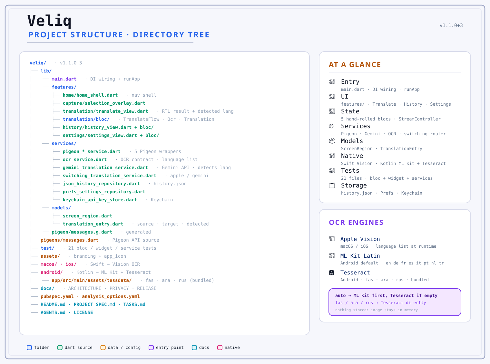

### Architecture Layers

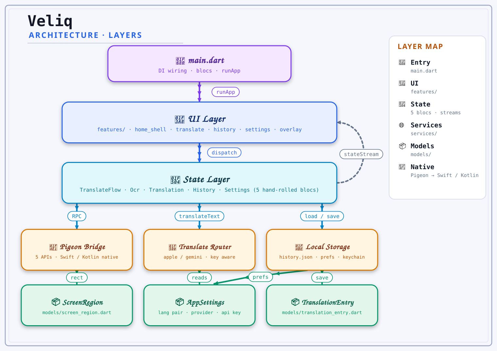

### Data Flow

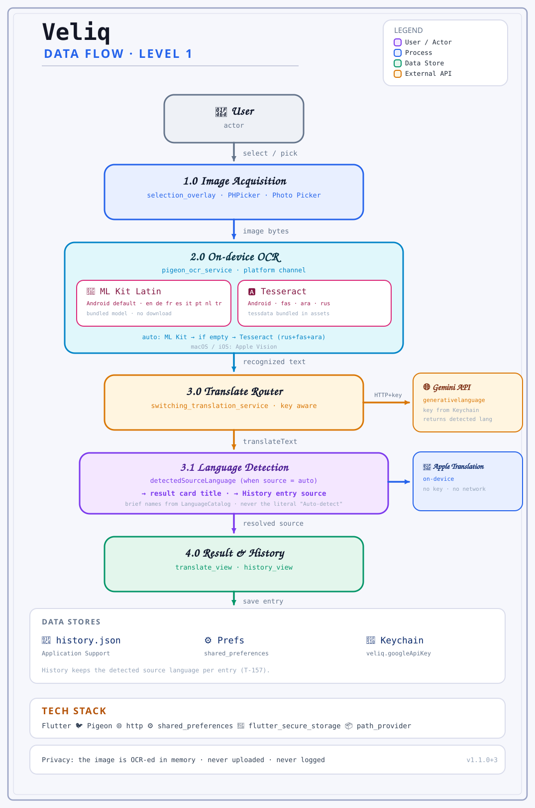

### Layer Breakdown

```text
lib/
├── main.dart                          → Entry point & service dependency wiring
├── features/                          → Feature-first UI and BLoC implementations
│   ├── home/                          → Navigation shell (Rail / Bottom Bar, Cmd+1/2/3)
│   ├── capture/                       → Screen region-selection overlay
│   ├── translation/                   → Translate flow: capture -> OCR -> translate -> save
│   ├── ocr/                           → OCR state management
│   ├── history/                       → History view & entry deletion
│   └── settings/                      → API key management & provider selection
├── services/                          → Interfaces + Pigeon native impls + translation providers
│   ├── selection/capture/ocr/...      → Service abstractions (faked in the test suite)
│   ├── pigeon_*.dart                  → Pigeon Swift/Kotlin implementations
│   ├── switching_translation_service.dart → Picks the provider stored in Settings
│   ├── google_translate_free_service.dart → Google Translate, keyless
│   ├── gemini_translation_service.dart→ Gemini REST client (user key)
│   ├── json_history_repository.dart   → history.json in Application Support
│   └── keychain_api_key_store.dart    → Keychain / Keystore secure storage
├── models/                            → Pure Dart data models (ScreenRegion, TranslationEntry, Language/LanguageCatalog)
└── pigeon/messages.g.dart             → Generated Pigeon bindings (do not edit)

macos/Runner/                          → Swift: ScreenCaptureKit, Vision OCR, Overlay Window
ios/Runner/                            → Swift: PHPicker, Camera ImageSourceHandler, Vision OCR
android/app/                           → Kotlin: Photo Picker, Camera FileProvider, ML Kit + Tesseract OCR
pigeons/messages.dart                  → Pigeon interface definitions
tool/gen_pigeon.sh                     → Regenerates the bindings (CI fails when they are stale)
test/                                  → Offline unit and widget test suite
```

## 📱 Platform Support

| Platform | Status | Notes |
|---|:---:|---|
| 🖥️ macOS | ✅ Works end to end | macOS 14.6+ — region select → Vision OCR → translation provider → history |
| 🤖 Android | ✅ Works end to end | Photo Picker + ML Kit/Tesseract OCR + keyless translation; verified on the emulator and on a physical Galaxy S24; signed APK in [the latest release](https://github.com/moradzadeh67/veliq/releases/latest) |
| 📱 iOS | 🟡 Simulator-verified | P7–P9 complete; picker, history and the first Vision OCR run verified on the iOS 26.5 simulator. Camera capture is untested on a physical iPhone. |
| 🪟 Windows | ❌ Out of scope | Desktop target limited to macOS |
| 🐧 Linux | ❌ Out of scope | Out of scope |

## 🔐 Permissions

> [!IMPORTANT]
> **macOS Screen Recording Permission**
> Veliq requires **Screen Recording** permission on macOS to capture selected screen regions.
> If the system prompt was dismissed, grant it manually:
> **System Settings → Privacy & Security → Screen Recording → enable Veliq**
> Fully quit and reopen Veliq after granting permissions.

> [!NOTE]
> - **iOS & Android Photos:** Picking photos via `PHPickerViewController` or the Android Photo Picker requires **zero permissions**.
> - **Camera:** The camera runtime permission is requested only when tapping *Take photo*.
> - Veliq does **not** require Accessibility or Full Disk Access permissions.

## 🔒 Privacy

> [!IMPORTANT]
> - **In-Memory Image Processing:** Captured screenshots and selected photos are kept solely in RAM and discarded immediately after OCR extraction.
> - **Text-Only Cloud Transmission:** Only the recognized text string leaves the device, and only towards the provider you choose — Google Translate's endpoint (the default, no key) or Gemini with your own key. Apple's on-device provider sends nothing. No image files are ever uploaded.
> - **Encrypted Credentials:** An API key, if you add one for Gemini, is stored securely in the macOS Keychain / Android Keystore — never in plain text.
> - **Local Data:** Translation history is saved locally in Application Support (`history.json`) and can be cleared at any time from the History tab.

Details: [docs/PRIVACY.md](docs/PRIVACY.md).

## 🚀 Installation & Running

> [!NOTE]
> **No API key needed.** Install, pick a language pair and start translating — the default provider
> (Google Translate, free) works without an account. A Gemini key is only required if you switch to
> Gemini in Settings.
>
> The signed Android APKs for **v1.2.0** are on the
> [Releases page](https://github.com/moradzadeh67/veliq/releases/latest) (`minSdk 24`). Pick the file
> that matches your phone's CPU: `app-arm64-v8a-release.apk` (any recent phone),
> `app-armeabi-v7a-release.apk` (older 32-bit devices) or `app-x86_64-release.apk` (emulators). macOS
> and iOS are built from source with the steps below — there is no notarized desktop build yet.

### Prerequisites

- [Flutter SDK](https://docs.flutter.dev/get-started/install) (v3.47.2)
- Dart SDK (^3.13.2)
- Platform-specific:
  - **macOS**: Xcode 15+ (development used Xcode 27.0), macOS 14.6+
  - **iOS**: Xcode 15+, iOS 16.0+, CocoaPods
  - **Android**: Android Studio / Android SDK 24+ (`minSdk 24`)
- Nothing else: the default provider (Google Translate, free) needs no key. Optionally, a
  [Google Gemini API key](https://aistudio.google.com/apikey) if you prefer the Gemini provider.

### Getting Started

1. **Clone the repository**:
   ```bash
   git clone https://github.com/moradzadeh67/veliq.git
   cd veliq
   ```

2. **Install dependencies**:
   ```bash
   flutter pub get
   ```

3. **Run the application**:
   ```bash
   flutter run -d macos
   flutter run -d "iPhone 17 Pro Max"
   flutter run -d <android-device-id>
   ```

### Building

```bash
# Build the macOS app
flutter build macos --release

# Verify the iOS build configuration (no signing yet)
flutter build ios --no-codesign

# Build the Android APK (signed with the upload key — see Release Signing below)
flutter build apk --release
```

> [!IMPORTANT]
> **First Launch on macOS:**
> On unsigned developer builds, macOS Gatekeeper may block double-clicking the app bundle. Right-click `Veliq.app` and choose **Open** once to bypass the Gatekeeper warning.

## 🧪 Testing & Quality Assurance

The test suite runs 100% offline using service-interface fakes. No permissions, network calls, or API keys are required during test execution.

```bash
# Analyze code for errors and lint compliance (must report zero issues)
flutter analyze

# Run unit and widget tests (268 passing tests)
flutter test
```

## 🔐 Release Signing

Android release builds are signed with the project's **upload key** (`Veliq-upload.jks`, alias
`veliq`). The keystore lives **outside** this repository; its credentials are read from
`android/key.properties`, which is git-ignored and never committed.

```properties
# android/key.properties — NEVER commit this file
storePassword=YOUR_STORE_PASSWORD_HERE
keyPassword=YOUR_KEY_PASSWORD_HERE
keyAlias=YOUR_KEY_ALIAS_HERE
storeFile=/absolute/path/to/your/upload-keystore.jks
```

Create your own upload key with `keytool`:

```bash
keytool -genkeypair -v \
  -keystore ~/keystores/veliq.jks \
  -storetype PKCS12 -keyalg RSA -keysize 2048 -validity 10000 \
  -alias veliq \
  -dname "CN=your-name, OU=Mobile, O=Veliq, C=IR"
```

Then build and verify the signed artifacts:

```bash
flutter build appbundle --release   # → build/app/outputs/bundle/release/app-release.aab
flutter build apk --release         # → universal build/app/outputs/flutter-apk/app-release.apk
flutter build apk --release --split-per-abi  # → per-ABI APKs, what the 1.2.0 release ships

# Confirm which key signed it
$ANDROID_HOME/build-tools/<version>/apksigner verify --print-certs \
  build/app/outputs/flutter-apk/app-release.apk
```

> [!NOTE]
> If `android/key.properties` is missing — on a fresh clone, for example — Gradle automatically falls
> back to the debug signing key. The build never breaks; it simply is not signed with the release key.

> [!CAUTION]
> Back up your keystore and its passwords somewhere safe. If the upload key is lost you can no longer
> publish updates for `com.moradzadeh67.veliq`.

### R8 / ProGuard (release builds)

Android `--release` builds run **R8** (minify + resource shrinking, full mode) by default. Libraries
that load classes reflectively must keep them from being stripped or renamed. Veliq protects the
bundled ML Kit recognizer with [`android/app/proguard-rules.pro`](android/app/proguard-rules.pro),
wired into the release build type in `android/app/build.gradle.kts` (`proguardFiles(...)`).

> [!WARNING]
> Debug builds do **not** run R8, so a missing keep rule only surfaces in `--release` — typically as a
> launch crash while the OCR client is created (`TextRecognition.getClient()`). Always smoke-test a
> release APK after touching OCR code, dependencies or build configuration.

## 🔄 CI/CD

| Workflow | Trigger | What it does |
|---|---|---|
| [`ci.yml`](.github/workflows/ci.yml) | push & PR to `main` | Runs `flutter analyze` and `flutter test` on Flutter 3.47.2 |

> [!NOTE]
> No release pipeline exists yet (see [docs/RELEASE.md](docs/RELEASE.md)). There is no web target,
> and no secrets or API keys live in this repository — the default provider needs none, and an optional
> Gemini key is entered by the user at runtime.

## ⚠️ Known Limitations

- **iOS Camera in Simulator:** The iOS Simulator does not support camera capture hardware; camera workflows require a physical iPhone.
- **iOS Verification:** The iOS target is verified on the simulator only — picker cancel, history across restarts and the first Vision OCR run (iOS 26.5). Camera capture has never been run on a physical iPhone.
- **Android OCR Scope:** The bundled ML Kit model reads Latin scripts (`en`, `de`, `fr`, `es`, `it`, `pt`, `nl`, `tr`); a bundled Tesseract engine adds Persian, Arabic and Russian (`fa`, `ar`, `ru`). Chinese, Japanese and Korean are disabled in Settings on Android because Veliq ships no model for them (Devanagari is not in the catalog at all).
- **Handwriting and blackletter are unreliable:** handwriting, Fraktur/Gothic fonts and heavily stylised text are frequently misread by both Android engines. Veliq reports that the photo was probably misread instead of showing gibberish, but it will not translate them.
- **Printed Russian accuracy depends on the photo:** shadows, skew and low resolution hurt Tesseract. Image preprocessing is on the roadmap; the bundled models are the same on every device.
- **Persian OCR depends on the platform:** Apple Vision reports its supported languages at runtime, so what Veliq offers on macOS/iOS is exactly what that OS release supports.
- **Apple's on-device translation** needs macOS 26+, cannot be combined with Auto-detect (it needs a concrete source language) and has no Persian. The iOS target does not register Apple's translation channel, so choosing it there reports that translation is not available in this build.
- **Unsigned macOS Builds:** macOS Gatekeeper flags unsigned developer builds on first double-click launch, and there is no notarized desktop build yet. Android release builds are signed with the project upload key.

## ❓ Troubleshooting & FAQ

<details>
<summary><b>1. How do I fix "Screen Recording Permission Denied" on macOS?</b></summary>

Go to **System Settings → Privacy & Security → Screen Recording**, enable **Veliq**, and fully restart the app. Note that every rebuilt debug binary counts as a new app, so the grant may need to be repeated.
</details>

<details>
<summary><b>2. Are my screenshots or photos uploaded to cloud servers?</b></summary>

No. Screenshots and photos are held in system RAM during local OCR text extraction and discarded immediately. Only the extracted plain-text string is sent on, and only to the translation provider you selected — Google Translate (the default) or Gemini. Apple's on-device provider sends nothing at all.
</details>

<details>
<summary><b>3. Do I need an API key?</b></summary>

No. Fresh installs use **Google Translate (free)**, which needs no account and no key — it is also the provider that works from Iran without a VPN. A key is only needed if you switch to **Gemini**, and existing installs keep whatever provider they had already stored.
</details>

<details>
<summary><b>4. How do I get a Google Gemini API key?</b></summary>

Visit [Google AI Studio](https://aistudio.google.com/apikey), log in with a Google account, create an API key, and paste it into Veliq's **Settings** tab. Note that Gemini is only reachable from Iran through a VPN; the free Google Translate provider is not affected.
</details>

<details>
<summary><b>5. Where is my translation history stored?</b></summary>

History is stored locally in `history.json` within your OS Application Support directory (`~/Library/Containers/com.moradzadeh67.veliq/Data/Library/Application Support/com.moradzadeh67.veliq/history.json` on macOS; `/data/data/com.moradzadeh67.veliq/files/history.json` on Android). It can be deleted from the History tab.
</details>

<details>
<summary><b>6. Why does camera capture fail on the iOS Simulator?</b></summary>

Apple's iOS Simulator does not emulate camera hardware (`UIImagePickerControllerSourceTypeCamera`). Use the photo library picker in the simulator or test on a physical iOS device.
</details>

<details>
<summary><b>7. Which languages does each platform read?</b></summary>

It depends on the platform's OCR, not on the translator. On **Android** Veliq bundles two engines: **ML Kit Latin** (`en`, `de`, `fr`, `es`, `it`, `pt`, `nl`, `tr`) and **Tesseract** for the scripts ML Kit has no model for — Persian, Arabic and Russian (`fas`, `ara`, `rus`). Both run offline; the image never leaves the device. With Auto-detect the Latin model runs first and, when its confidence is low, the Tesseract result competes with it (the higher confidence wins, and an unreadable photo is refused instead of showing gibberish). Chinese, Japanese and Korean are still macOS/iOS-only, so Settings shows those disabled on Android. On **macOS/iOS** the list comes from **Apple Vision** at runtime (`VNRecognizeTextRequest.supportedRecognitionLanguages()`), so a language is offered only if that macOS/iOS version can read it. Auto-detect is always available as the source. See D-018 in [docs/ARCHITECTURE.md](docs/ARCHITECTURE.md).
</details>

## 💻 Development Environment

This project is developed and tested on:

* Hardware: MacBook Pro (Apple M3 Pro, 18 GB)
* OS: macOS 27.0.1
* IDE: VS Code / Android Studio
* Xcode: 27.0
* Flutter: 3.47.2 • channel stable
* Dart: 3.13.2

## 📋 Requirements

* Flutter SDK: 3.47.2
* Dart SDK: ^3.13.2
* macOS target: macOS 14.6+
* iOS target: iOS 16.0+
* Android: SDK 24+ (`minSdk 24`)

## 🙏 Credits & Attribution

Veliq is built with:
- [Flutter](https://flutter.dev) & [Dart](https://dart.dev)
- [Pigeon](https://pub.dev/packages/pigeon)
- [Apple Vision](https://developer.apple.com/documentation/vision) & [ScreenCaptureKit](https://developer.apple.com/documentation/screencapturekit)
- [ML Kit Text Recognition](https://developers.google.com/ml-kit/vision/text-recognition/v2) & [Tesseract4Android](https://github.com/adaptech-cz/Tesseract4Android)
- [`flutter_secure_storage`](https://pub.dev/packages/flutter_secure_storage)
- [Google Gemini API](https://ai.google.dev/)

> ℹ️ Veliq needs **no key** to start translating: the default provider is Google Translate's free
> endpoint. A Gemini key is optional, entered at runtime and stored only on your device.

## 🤝 Contributing

Contributions are welcome! Please read [CONTRIBUTING.md](CONTRIBUTING.md) for guidelines on how to get started.

## 📄 License

This project is licensed under the **MIT License** — see [LICENSE](LICENSE) for details.

Copyright © 2026 Mohammadreza Moradzadeh ([@moradzadeh67](https://github.com/moradzadeh67))
