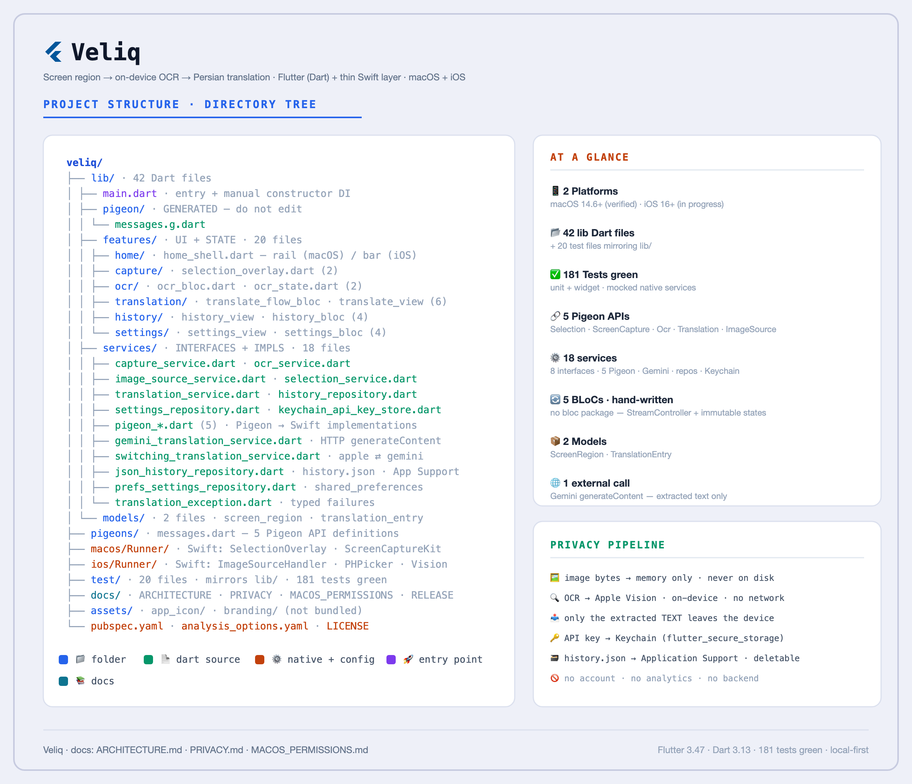
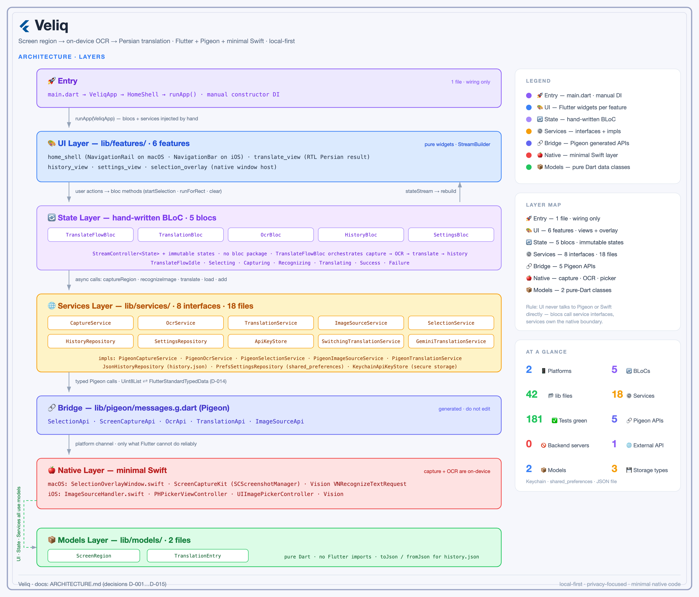
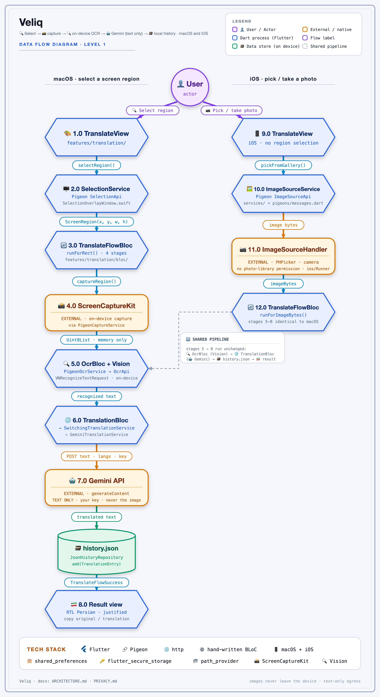

# 🌐 Veliq


Select any region of your screen, extract its text on-device, and read it in Persian.

[](https://opensource.org/licenses/MIT)
[](https://flutter.dev/platforms)
[](https://flutter.dev)
[](https://dart.dev)

**Contents:** [Status](#-status) · [Why I Built This](#-why-i-built-this) · [Screenshots](#-screenshots) · [Features](#-features) · [Tech Stack](#️-tech-stack) · [Testing](#-testing) · [Architecture](#️-architecture) · [Platform Support](#-platform-support) · [Permissions](#-permissions) · [Privacy](#-privacy) · [Installation](#-installation) · [Development Environment](#-development-environment) · [Roadmap](#️-roadmap) · [Known Limitations](#️-known-limitations) · [Development Approach](#-development-approach) · [Contributing](#-contributing) · [Credits & Attribution](#-credits--attribution) · [License](#-license)

## 📌 Status

Works end to end on **macOS 14.6+** for personal use: region select → on-device OCR → Gemini translation →
local history. The **iOS port** (P7–P9) is nearly there — photo-library and camera input, bottom navigation,
SafeArea-aware layout and Application Support storage are implemented and simulator-verified, but it is
**not device-verified** (no physical device in scope; the camera can never be simulator-tested). Builds are
unsigned; the public-release checklist lives in [docs/RELEASE.md](docs/RELEASE.md).

## 💡 Why I Built This

<!-- TODO: to be written by Mohammadreza himself (first person, ~3 short paragraphs, like the
     classic_code_editor README). Worth covering: why the screen -> Persian text loop matters
     to you, why a local-first tool instead of a browser service, and what Veliq is for you. -->

## 📸 Screenshots

<!-- TODO (together with the user) — assets/screenshots/*.png, table at width 280 like classic_code_editor:
       macOS: idle / region-selection overlay / result view / history / settings
       iOS (iPhone 17 Pro Max simulator): translate / result / history / settings
     TODO: add a 15-30 s demo GIF at docs/demo.gif (clean history, no personal content):
       
-->

## ✨ Features

### 🪟 Region capture (macOS)

- Drag-select any region of the screen from a full-screen overlay; `Esc` cancels
- Capture with **ScreenCaptureKit**, OCR with **Apple Vision** — both on-device
- Screenshots are held in memory and discarded; nothing is written to disk

### 📷 Photos (iOS)

- Pick a photo from the library (`PHPickerViewController`, no permission required) or take one with the camera
- Same on-device OCR (Vision), same translation path
- No region selection is possible on iOS — you choose an existing or a new photo

### 🔍 OCR and translation

- On-device OCR (Apple Vision) on both platforms
- Translation with **Google Gemini** using **your own API key**
- Right-to-left, justified Persian result view; copy the original or the translation

### 📚 History and settings

- Local, deletable translation history (`history.json` in Application Support)
- API key stored in the **macOS Keychain** — never in plain-text preferences
- Language pair and provider settings in `shared_preferences`

### 📱 Navigation

- `NavigationRail` on macOS, bottom `NavigationBar` + `SafeArea` on iOS

### ⌨️ Keyboard shortcuts (macOS, T-129)

- `Cmd+1` / `Cmd+2` / `Cmd+3` — switch tabs
- `Cmd+R` — start capture (region selection on macOS, gallery picker on iOS)
- `Esc` — start over from the result/failure screen (and cancel the selection overlay, as before)
- `Cmd+C` — copy the translation
- `Enter` in the Settings API-key field — save & test

## 🛠️ Tech Stack

- **Framework:** Flutter 3.47.2 — one codebase for macOS and iOS
- **Language:** Dart 3.13.2+
- **Native layer:** Swift — ScreenCaptureKit + Vision + selection window (macOS), Vision + PHPicker + camera (iOS)
- **Bridge:** [Pigeon](https://pub.dev/packages/pigeon) 29 — type-safe Dart ↔ Swift, generated code
- **State management:** hand-written BLoC (`TranslateFlowBloc`, `OcrBloc`, `HistoryBloc`, `SettingsBloc` — no
  `bloc` package)
- **Settings:** [`shared_preferences`](https://pub.dev/packages/shared_preferences)
- **API key:** [`flutter_secure_storage`](https://pub.dev/packages/flutter_secure_storage) → macOS Keychain
  (legacy keychain, so it works without a paid Apple developer account)
- **HTTP:** [`http`](https://pub.dev/packages/http) — Gemini REST calls
- **Paths:** [`path_provider`](https://pub.dev/packages/path_provider) — `getApplicationSupportDirectory()`
- **Architecture:** feature-first — Dart owns UI, state, orchestration and storage; Swift owns native capability

## ✅ Testing

The suite runs fully offline: capture, OCR, translation and storage are fakes behind the service interfaces, so
no permission prompt, no screen capture, no Gemini call and no API key are involved.

```bash
# Static analysis must report zero issues
flutter analyze

# Unit + widget tests (187)
flutter test

# iOS build check (no signing needed)
flutter build ios --no-codesign
```

## 🏗️ Architecture

Dart owns the UI, state, orchestration and storage; Swift owns the native capabilities. The two sides talk over
a small, Pigeon-generated interface. Decisions and their status (with sources for platform claims) are recorded
in [docs/ARCHITECTURE.md](docs/ARCHITECTURE.md).

### How it works

```text
macOS: select region (Swift overlay) -> capture (ScreenCaptureKit) -> OCR (Vision, on-device)
         -> extracted text -> Gemini API (text only) -> result view + local history
iOS:   pick photo / take photo (Swift) -> OCR (Vision, on-device)
         -> extracted text -> Gemini API (text only) -> result view + local history
```

### Project Structure



### Architecture Layers



### Data Flow



### Layer Breakdown

```text
lib/
├── main.dart                          entry point; service wiring
├── features/                          one folder per feature (UI + its bloc)
│   ├── home/                          navigation shell (rail / bottom bar, Cmd+1/2/3)
│   ├── capture/                       region-selection overlay widget
│   ├── translation/                   translate screen + flow bloc: capture -> OCR -> translate -> save
│   ├── ocr/                           OCR state
│   ├── history/                       saved translations
│   └── settings/                      provider, language pair, API key
├── services/                          interfaces + Pigeon/native impls + Gemini impl + storage
│   ├── selection/capture/ocr/...      abstract service interfaces (each faked in tests)
│   ├── pigeon_*.dart                  Pigeon-backed implementations talking to Swift
│   ├── gemini_translation_service.dart Gemini REST client
│   ├── switching_translation_service.dart  key present -> Gemini, otherwise stub
│   ├── json_history_repository.dart   history.json in Application Support
│   ├── keychain_api_key_store.dart    API key in the macOS Keychain
│   └── prefs_settings_repository.dart settings in shared_preferences
├── models/                            pure Dart data (ScreenRegion, TranslationEntry)
└── pigeon/messages.g.dart             generated Pigeon bindings — do not edit

macos/Runner/                          Swift: SelectionOverlayWindow, ScreenCaptureKit capture, Vision OCR
ios/Runner/                            Swift: ImageSourceHandler (PHPicker + camera)
pigeons/messages.dart                  Pigeon definitions
test/                                  mirrors lib/ (service interfaces faked)
```

### Decisions

| Topic | Choice | Why |
|---|---|---|
| State management | BLoC pattern (hand-written, no `bloc` package) | testable, UI-independent state |
| Dart ↔ Swift | Pigeon | type-safe bridge, generated code |
| Screen capture | ScreenCaptureKit | `CGWindowListCreateImage` is obsoleted in the macOS 15 SDK |
| OCR | Apple Vision | on-device, no network |
| Translation | Gemini API via a `TranslationService` interface | Apple's Translation framework does not cover Persian |
| API key storage | Keychain via `flutter_secure_storage` (legacy keychain) | works without a paid Apple developer account |

## 📱 Platform Support

| Platform | Status | Notes |
|---|:---:|---|
| 🖥️ macOS | ✅ Works end to end | macOS 14.6+ — region select → OCR → translate → history |
| 📱 iOS | 🔜 In progress | P7–P9; simulator-verified (iPhone 17 Pro Max), not device-verified |
| 🪟 Windows | ❌ Out of scope | see [PROJECT_SPEC.md](PROJECT_SPEC.md) — "Out of scope" |
| 🐧 Linux | ❌ Out of scope | as above |
| 🤖 Android | ❌ Out of scope | as above |

## 🔐 Permissions

On macOS, Veliq asks for **Screen Recording** only. If you dismissed the prompt, enable it manually:

> System Settings → Privacy & Security → Screen Recording → enable **Veliq**

Fully quit and reopen Veliq after changing this setting. Veliq does **not** request Accessibility, Full Disk
Access, or any other permission. On iOS, Veliq asks for the **Camera** only when you tap *Take photo*; picking
from the photo library uses `PHPickerViewController`, which needs no permission at all.
See [docs/MACOS_PERMISSIONS.md](docs/MACOS_PERMISSIONS.md).

## 🔒 Privacy

- Capture and OCR are entirely on-device; screenshots and picked photos are held in memory and discarded.
- Only the recognized **text** is sent to Google's Gemini API, with your own key. On the free tier Google may use
  that text to improve its products, and human reviewers may read it; users in the EEA, Switzerland and the UK are
  covered by the paid-tier terms. Terms change: check Google's current Gemini API terms.
- Your API key is stored in the Keychain, not in plain-text preferences.
- Translation history lives in the app's Application Support directory
  (`getApplicationSupportDirectory()`), i.e.
  `~/Library/Containers/com.moradzadeh67.veliq/Data/Library/Application Support/veliq/history.json` on macOS
  (the app is sandboxed), and can be cleared from the History screen.
- No account, no analytics, no backend.

Details: [docs/PRIVACY.md](docs/PRIVACY.md).

## 🚀 Installation

### Download pre-built release

No release is published yet — Veliq is unsigned and its release checklist
([docs/RELEASE.md](docs/RELEASE.md)) is still open. Until then, build from source:

### Build from source

```bash
# Clone
git clone https://github.com/moradzadeh67/veliq.git
cd veliq

# Install dependencies
flutter pub get

# Run (macOS or the iOS simulator)
flutter run -d macos
flutter run -d "iPhone 17 Pro Max"

# Build a release bundle
flutter build macos --release
```

**First run**

1. Open **Settings**, paste your API key, and press **Save & test**.
2. Grant **Screen Recording** when macOS asks (see [Permissions](#-permissions)).
3. Open **Translate**, click **Select region**, and drag over the text.

First launch of an unsigned build: macOS may refuse to open it by double-click. Right-click the app and choose
**Open** once. <!-- TODO: verify the exact prompts on a clean Mac / second user account -->

### System requirements

- macOS 14.6 or later (the Xcode deployment target), or iOS 16.0 or later
- Flutter 3.47.2 / Dart 3.13.2+ — only to build from source
- **Screen Recording** permission on macOS; **Camera** on iOS (only for *Take photo*)
- A Google Gemini API key (create one in [Google AI Studio](https://aistudio.google.com/apikey))

## 💻 Development Environment

Actively developed and tested on:

- **Hardware:** MacBook Pro (Apple M3 Pro)
- **OS:** macOS 27.0.1
- **IDE:** Android Studio / IntelliJ
- **Xcode:** 27.0
- **Flutter:** 3.47.2 (stable)
- **Dart SDK:** 3.13.2

### Requirements

- Dart SDK `^3.13.2`
- macOS 14.6+ or iOS 16.0+
- An iPhone 17 Pro Max simulator for the iOS side (no physical device in scope)

## 🗺️ Roadmap

- [x] P0 — Scaffold
- [x] P1 — Research & decisions
- [x] P2 — Capture MVP
- [x] P3 — OCR
- [x] P4 — Translation
- [x] P5 — History & settings
- [x] P6 — Polish & release
- [x] P7 — iOS research
- [x] P8 — iOS image acquisition
- [ ] P9 — iOS UI & storage adaptation *(in progress — T-124 simulator review remains)*
- [x] P10 — Branding & icons
- [ ] P11 — Keyboard affordances *(in progress — in-app shortcuts done, system-wide hotkey open)*
- [ ] System-wide capture hotkey (T-130) — blocked on two open decisions
- [ ] First public release — [docs/RELEASE.md](docs/RELEASE.md)

The canonical phase and task list lives in [TASKS.md](TASKS.md).

## ⚠️ Known Limitations

- Displays placed **above** the main one (negative-coordinate layouts) were not reproducible to test; Retina and
  a side-by-side second display are verified (T-063).
- Builds are unsigned; see "Installation" for first launch.
- The global capture shortcut is not implemented yet (T-130).
- **iOS camera is never simulator-testable**: the simulator has no camera (T-118 dropped — no device in scope).
  Everything else in the iOS review (T-124) is verified on the simulator; a short remainder checklist stays open.
- On iOS there is no region selection: you pick an existing photo or take a new one.

## 🤖 Development Approach

Architecture, decisions and review are mine; routine implementation tasks were split into small, verifiable
tasks and partly executed with AI assistants under written rules (`AGENTS.md`, `TASKS.md`). Every change goes
through tests, `flutter analyze` and a manual check before it is committed.

## 🤝 Contributing

Contributions, issues and feature requests are welcome — see the
[issues page](https://github.com/moradzadeh67/veliq/issues). Work is planned in
[TASKS.md](TASKS.md) under the rules in [AGENTS.md](AGENTS.md): one task at a time, tests +
`flutter analyze` + a manual check before any commit.

## 🙏 Credits & Attribution

Built on [Flutter](https://flutter.dev), [Dart](https://dart.dev),
[Pigeon](https://pub.dev/packages/pigeon),
[Apple Vision](https://developer.apple.com/documentation/vision),
[ScreenCaptureKit](https://developer.apple.com/documentation/screencapturekit),
[`flutter_secure_storage`](https://pub.dev/packages/flutter_secure_storage), and the
[Gemini API](https://ai.google.dev/).

## 📄 License

This project is licensed under the MIT License — see [LICENSE](LICENSE) for details.

Copyright © 2026 Mohammadreza Moradzadeh ([@moradzadeh67](https://github.com/moradzadeh67))
